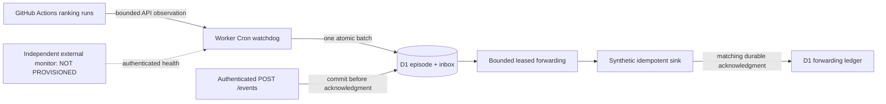

# Ops27 — isolated Workers/D1 integration

Date: 2026-10-13 UTC. Base: `main@944e4174444a32ba7182db62f644e5a433dcee67`.
Branch: `spike/atp-ops27-cloudflare-workers-d1`.
Draft: [PR #34](https://github.com/hmono/Luka-Tennis-Player/pull/34).
Epic: [#33](https://github.com/hmono/Luka-Tennis-Player/issues/33).

## Scope, models and isolation

The coordinator read issue33, PR32 metadata/contracts, Ops26 integration,
inbox/sink, watchdog and independent-review reports before integration. Main was
verified remotely at944e417; PR32 remains draft at a21143f and is not merged.
The original primary checkout was dirty and was not modified. All new work uses
lightweight sparse worktrees sharing existing Git objects. Initial read-only
`df` showed95% disk use, approximately2.4GiB available; a later read showed96%,
approximately2.2GiB available. The first four worktrees together occupied less
than3MiB at the recorded intermediate check. No capacity expansion, services,
cleanup, FP&A changes, local dependency installation or local build occurred.

Three new agents were explicitly spawned concurrently as GPT-6.1 Sol/high.
The coordinator cannot change or verify the client-selected session model by
tool; no unsupported claim of switching the coordinator model is made. The
independent review was explicitly spawned as a new GPT-6 Astra/max agent after
integration, separate from all implementers.

| Workstream | Isolated worktree | Exclusive ownership | Original commits |
| --- | --- | --- | --- |
| A feasibility | `/home/ono/ops27/feasibility` | `ops27-cloudflare-feasibility.md` | `211f92f` |
| B inbox | `/home/ono/ops27/inbox` | inbox/forwarding/repository, inbox tests/report | `31aeda2` |
| C watchdog | `/home/ono/ops27/watchdog` | watchdog/App/client, watchdog tests/report | `ffa7b20`, `353d1f0` |
| Coordinator | `/home/ono/ops27/integration` | shared schema/config/entrypoint/CI/integration tests | integration branch |
| Independent review | `/home/ono/ops27/independent-review` | adversarial tests and report only | review evidence follows |

The coordinator inspected all three reports and production patches before
incorporation. Shared files were written only by the coordinator. Corrections
required by independent review belong to the coordinator, not the reviewer.

## Architecture and transaction boundaries

The PoC combines handlers in one local Worker. D1 uses primary reads and atomic
batches; no read-replication session is used for dedup, leases or reservations.
The watchdog and inbox share the durable event table, eliminating a network gap
between incident persistence and inbox admission. An incident/recovery episode
cannot commit if its new outbox event fails capacity or conflicts. Acknowledgment
loss replays the same immutable identity, including after a logical restart.

The forwarded ledger means the next hop durably accepted an event. It makes no
claim about WhatsApp, a device, a visible channel or an operator. The sink in all
tests is synthetic; `SINK_NO_GO` remains. Forwarding can progress while GitHub
observation is unavailable. A permanently failing event backs off and ultimately
remains explicitly quarantined; subsequent due events can progress.

Version1 migration contains `ops_events`, `ops_inbox_limits`,
`ops_inbox_totals`, `ops_forward_slots`, `ops_inbox_audit`, `watchdog_state`,
`watchdog_episodes`, and `watchdog_dispatches`. Limits and counters are updated
transactionally by triggers. Health uses counters and indexed oldest-event
lookups, avoiding an audit-table scan on every probe. Event deletion is denied;
retirement retains exact canonical content and dedup identity. Migrations are
reproducible using local Wrangler and are exercised twice in CI.

Ported Ops26 contracts explicitly: immutable event identity/message, strict
boolean accepted plus matching event_id, commit before ack, ambiguity-safe replay,
total HTTP deadlines, bounded history/401 renewal, durable403/429 cooldown,
repository-scoped App grants, repeated disabled episodes, and dispatch budget.
No Python/systemd/flock/process transport implementation was copied or merged.

## Budgets and external qualification

Final defaults: ten-minute candidate Cron (not installed), four forwarding slots,
four attempts per invocation, ten-second sink deadline, twelve attempts per event,
one-hour backoff ceiling, five GitHub pages/500 recent runs, and fifteen-second
GitHub exchange deadline. Two dispatch reservations per slot require all explicit
release/recovery gates, active workflow and thirty-minute durable cooldown.
There is no enable-workflow call. Missing Cron is observable through stale health;
total Cloudflare failure requires a monitor outside Cloudflare and GitHub.

PoC admission is capped at10000 identities,1000 unresolved events and8MiB
canonical payload. Total D1 bytes also include indexes/audit/SQLite overhead;
this has not been measured in a production account. With average4KiB canonical
events,8MiB holds about2048 events: at the feasibility stress assumption100/day,
backpressure could occur in approximately20days. This is an explicit engineering
cap, not an indefinitely sustainable production retention policy. Normal actual
event volume is unmeasured. Archive/restore and quarantine reconciliation remain
activation blockers. No pending event is silently discarded to hide saturation.

[Feasibility](ops27-cloudflare-feasibility.md) models15960 monthly invocations
and a dedicated Workers Paid floor of US$5/month plus unverified monitoring,
sink, backup and shared-account use. Its sixteen-fetch/eight-sink-attempt capacity
example is a proposal; integrated forwarding defaults to four. Actual CPU time,
D1 rows read/written, total byte growth and account residual quotas remain
`NOT_VERIFIED`. Worst-case retries/queries need Paid sizing; Free compatibility
is not claimed. No request authentication scheme constitutes a financial hard cap.

Secrets/principals remain an external gate. Separate health and ingress bearer
credentials are enforced. The combined local Worker is not isolation between the
inbox and GitHub App key: before staging, split receiver/watchdog principals and
bindings or obtain an explicit decision on that risk. Public HTTP handlers must
not receive a production App key by default. Production GitHub delivery-variable
coherence, App installation scope and real credential rotation remain unverified.

## Validation evidence

Local ONO checks were lightweight only: whitespace, native Node TypeScript syntax,
synthetic WebCrypto signing and small in-memory SQLite schema/transaction smokes.
The coordinator generated an npm lockfile with `--package-lock-only
--ignore-scripts`; no local `node_modules` or dependency execution was created.
These are not workerd or remote-D1 proofs.

Remote validation uses GitHub-hosted Ubuntu with Node24, pinned lockfile,
Workers Vitest integration/workerd, actual local D1 migrations and synthetic
GitHub/sink responses. It receives no Cloudflare/App/provider secrets and has only
`contents: read`. The workflow only typechecks, migrates locally, tests and bundles
with Wrangler `--dry-run`. It contains no deploy, production resource creation,
workflow enable or ranking-delivery invocation.

Initial [CI at c05c0e6](https://github.com/hmono/Luka-Tennis-Player/actions/runs/38468203824)
failed typechecking before tests due to SDK namespace/decoder/crypto/URL typing
differences. `ab6db0a` corrected those integration issues. Final CI, independent
findings and regression results are recorded below; no initial
failure is represented as a passing runtime test.

The next run passed typechecking and applied the migration twice, but Vitest5's
host filesystem module cache prevented tests from loading inside workerd.
Disabling `fsModuleCache` in the isolated Workers test configuration resolved that
toolchain issue. [CI at e2f1862](https://github.com/hmono/Luka-Tennis-Player/actions/runs/38468986668)
then executed63 tests:55 passed and8 failed. All eight exposed D1's trigger-inclusive
`meta.changes`: a committed forward was reported false and one retired event was
reported as two. `56b8d9a` switched event-update counts to `RETURNING event_id`;
this is why the SQLite smoke was not treated as sufficient D1 evidence.

Independent Astra/max review reproduced two P1s on the original source:
`RUN_FAILURE` was prematurely recovered while a replacement was queued/running,
and a stale scheduler could dispatch after lease loss/expiry with cooldown dated
at invocation start. `e2f1862` preserves failure until completed success, checks
fresh lease authority before reservation/POST, rechecks after token acquisition,
fences completion, and records actual reservation time. `56b8d9a` also checks the
lease after inspection and before reconciliation. Migration0002 adds the lease
lookup index requested for a P2 retained-history scan. Eight independent tests
include after-token authority loss and full-capacity recovery rollback.

Existing repository regression at
[ab6db0a](https://github.com/hmono/Luka-Tennis-Player/actions/runs/38468546601)
passed283 Python tests,81 frontend tests and Next static build/export. The count
is the main-based suite; it intentionally does not include the319-test Python
suite from unmerged PR32. Final corrected-SHA evidence follows separately.

### Final corrected code and test result

At `0c554813358106ab9730680d8c3fb2dc9e914cdd`:

| Execution / scope | Observed result | Evidence |
| --- | --- | --- |
| GitHub CI, workerd + local synthetic D1 | **71 tests passed**, four files, including eight independent adversarial tests; strict TypeScript passed; migrations0001/0002 applied and repeated with no remaining migration; Wrangler bundle dry-run passed | [Worker run38469406758](https://github.com/hmono/Luka-Tennis-Player/actions/runs/38469406758) |
| GitHub CI, existing repository regression | **283 Python +81 frontend tests and Next build/export passed** | [Release checks38469406464](https://github.com/hmono/Luka-Tennis-Player/actions/runs/38469406464) |
| Independent Astra/max recheck | Both reproduced P1s closed; lease lookup P2 closed; D1 trigger-count reporting corrected; **CODE_GO for the disabled PoC** | [Independent review](ops27-independent-review.md) |
| ONO local execution | Syntax/whitespace, synthetic RSA and small SQLite smokes only; no dependency install/build | Agent reports and local checks above |
| Actual external homologation | **None**: D1 remote, Cron deployment, TLS, App, sink/channel, monitor and backup remain unprovisioned/unverified | Feasibility and independent review |

The reviewer independently fetched the successful workerd run and verified the
eight adversarial cases. No reproduced P0/P1 source finding remains open. The
independent report and this evidence may have later documentation-only commits;
the SHA above identifies the corrected runtime/test/configuration validation.

The web package only excludes the separate Workers package from its TypeScript
and Vitest discovery. Existing Pages deployment workflow, routes, DNS, TLS,
frontend application code, Python runtime, ATP data/snapshots/receipts and
`update_rankings.yml` are unchanged against the base. GitHub API read confirmed
the ATP workflow remains `disabled_manually`. New validation CI does not enable it.

### Supplemental HTTP concurrency regression

At `4961abb15a6741adf11a0c165a3e107c27b41efe`, an additional test exercises two
concurrent authenticated `POST /events` calls through the complete Worker
handler. Identical content returns two accepted responses with exactly one new
event; conflicting content with the same ID produces one200 and one409. This is a
test-only addition after the independently reviewed runtime.

[Worker CI38469737593](https://github.com/hmono/Luka-Tennis-Player/actions/runs/38469737593)
passed **72 tests**, including the eight independent regressions, plus strict
typechecking, both migrations followed by a no-op repeat, and the43.48KiB bundle
dry-run. [Repository checks38469737599](https://github.com/hmono/Luka-Tennis-Player/actions/runs/38469737599)
also passed at that SHA. The duplicate push run38469731733 stalled without step
logs and was cancelled; it is not counted as successful evidence. The equivalent
PR run above completed successfully. Subsequent commits only record evidence.

## Gates and next authorization

`CLOUDFLARE_CONDITIONAL_GO` is the engineering recommendation for this PoC;
binary deployment decision is `CLOUDFLARE_NO_GO` while account eligibility is
`NOT_VERIFIED`. `STAGING_NO_GO` and `ACTIVATION_NO_GO` are independent and remain
closed even after green mocks. **`CODE_GO` applies only to the reviewed disabled
PoC** with the final CI/review evidence above. This is not approval to merge or
provision production.

Needed credentials/resources: valid read-only account audit; separately named
staging Worker/D1 and budget; repository-restricted App/installation/RSA key;
separate ingress, health and sink secrets; qualified HTTPS/idempotent visible
operational destination; external supervisor/canal independent of both vendors;
encrypted external backup and restore/replay protocol. None was provisioned.

The next write authorization must explicitly name isolated staging resources,
cost ceiling, owners, minimal App permissions, synthetic sink/monitor tests,
backup/restore and rollback. It must not implicitly authorize production,
`collect-and-deliver`, a real WhatsApp send, enablement, merge or ONO installation.
Routine publication and installation-token renewal need no weekly human step in
the proposed runtime; initial setup, revocation, disaster and capacity maintenance
still need qualified automation and named owners.
